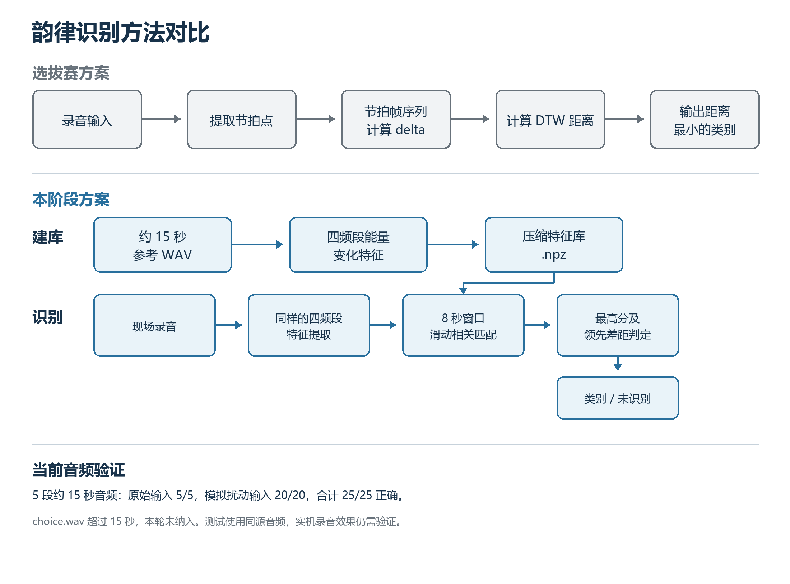

## 2. 优化韵律识别模型

选拔赛阶段，机器人使用 Librosa 提取音乐中的节拍点，将节拍帧序列经 `delta` 处理后，再用 DTW 计算录音与各参考音频的距离，最后选取距离最小的一首。实际使用中，这种做法的识别效果不够稳定，而且无论听到的音乐是否在曲库中，程序都会给出一个最接近的结果。

本阶段改为轻量级的离线韵律匹配。建库时，程序读取约 15 秒的 WAV 音频，将其转为 8 kHz 单声道，以 32ms 为步长提取四个频段的能量变化，并保存为体积较小的特征库。识别时对现场录音做相同处理，再用 8 秒窗口沿时间轴滑动比较。只有最高匹配分数和它与第二名的差距都达到门限，机器人才输出对应曲目；证据不足时返回“未识别”。这套方法只依赖 NumPy，不需要联网，适合放在树莓派上运行。

我们先用当前五段约 15 秒的音频做了技术验证：直接识别五段原始音频，结果为 5/5；加入起始延迟、噪声、轻微变速、限带和回声等模拟扰动后，结果为 20/20。将待测曲目从特征库中移除再识别，五次均返回“未识别”。现有 `choice.wav` 长约 106 秒，不符合本轮只使用约 15 秒音频的要求，因此没有参与建库和测试。这些结果来自同一批音频及其模拟变化，机器人实际播放和麦克风收音后的效果还需上机验证。
